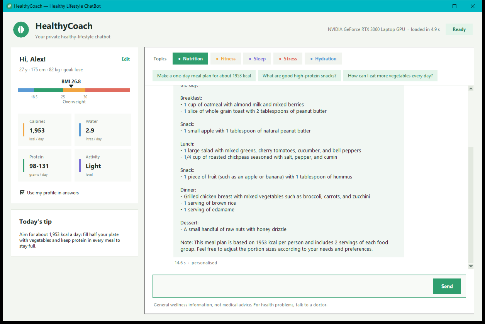
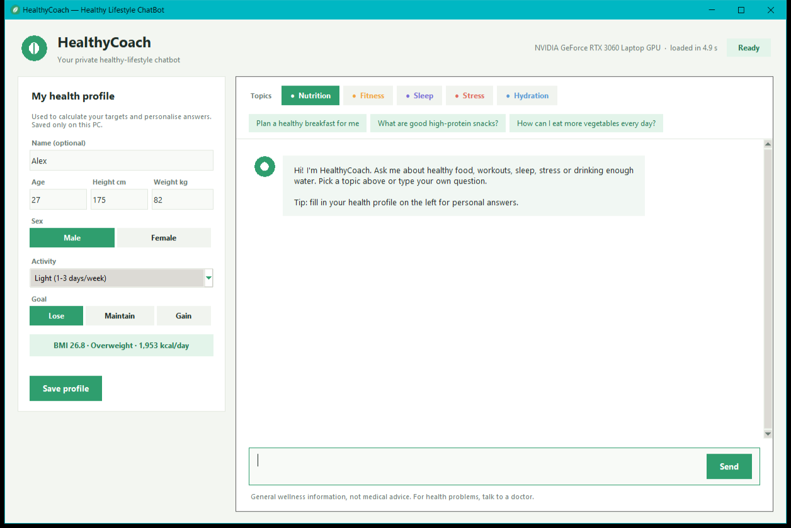

# HealthyLifeStyle ChatBot (HealthyCoach)

A private, offline healthy-lifestyle coach for **nutrition, exercise, sleep, stress and hydration**.
It runs a small language model that I fine-tuned on health topics, entirely on your own PC and GPU,
with a desktop dashboard that turns your health profile into daily targets and personal answers.



## Features

- **Fine-tuned model**: TinyLlama 1.1B Chat + a LoRA adapter trained on a curated health dataset.
- **Health profile dashboard**: BMI with a colour gauge, daily calorie, water and protein targets
  (Mifflin-St Jeor formula), with a live preview while you type.
- **Personal answers**: the profile is added to the model prompt (toggle on/off).
- **Topic chips**: Nutrition, Fitness, Sleep, Stress, Hydration with ready-made questions.
- **Streaming replies with Stop**, copy any message with right-click.
- **Runs on GPU** (NVIDIA CUDA) with automatic CPU fallback; fully offline after setup.
- **One-click start**: `HealthyCoach.exe`, no console window.



## How it works

1. **Dataset** (`healthbot/dataset.py`): filters the 51,760-example
   [alpaca-cleaned](https://huggingface.co/datasets/yahma/alpaca-cleaned) instruction set down to
   **913 healthy-lifestyle examples** by topic, removing off-topic matches (e.g. "team-building
   exercise", poems, coding) and very short answers.

   | Topic | Examples |
   |---|---|
   | Nutrition | 398 |
   | Stress | 207 |
   | Fitness | 178 |
   | Sleep | 62 |
   | Healthy habits | 58 |
   | Hydration | 10 |

2. **Prompt format** (`healthbot/prompt.py`): TinyLlama's native chat format with a coach system
   prompt. Every answer ends with the end-of-sequence token, so the model learns to stop.
3. **Training** (`healthbot/train.py`): LoRA (rank 16, alpha 32) on the attention projections,
   3 epochs, bf16, loss computed **only on the answer** (prompt tokens are masked).
4. **Evaluation** (`healthbot/evaluate.py`): loss on 45 held-out examples the model never saw.

### Results (RTX 3060 Laptop GPU, 6 GB)

| | Base TinyLlama | HealthyCoach adapter |
|---|---|---|
| Held-out loss | 1.097 | **1.012** |
| Held-out perplexity | 3.00 | **2.75** |

- Training time: **11.4 minutes** (868 training examples, 3 epochs), 4.5M trainable parameters (0.4%).
- Generation speed: about **25-30 tokens/s** on the GPU (about 4 tokens/s on CPU).
- Full numbers: `models/healthy_coach_adapter/training_report.json`.

## Setup (Windows)

1. Install Python 3.11+ (64-bit).
2. Double-click `INSTALL_WINDOWS.bat` (needs internet once). It installs the GPU build of PyTorch
   when an NVIDIA card is found (otherwise the CPU build) and downloads the TinyLlama base model.
3. Double-click **`HealthyCoach.exe`**. Windows SmartScreen may warn once because the exe is not
   code-signed: **More info → Run anyway**.

Other ways to run:

```bat
.venv\Scripts\python.exe app.py                 & rem desktop app with console
.venv\Scripts\python.exe -m healthbot.chat      & rem chat in the terminal
```

## Retrain or evaluate

```bat
.venv\Scripts\python.exe -m healthbot.dataset    & rem rebuild data\health_instructions.jsonl
.venv\Scripts\python.exe -m healthbot.train      & rem about 12 min on an RTX 3060
.venv\Scripts\python.exe -m healthbot.evaluate   & rem compare base vs adapter
.venv\Scripts\python.exe -m unittest discover -s tests -t .
```

## Project structure

```text
HealthyLifeStyle-ChatBot/
├── app.py                      # Desktop app (Tkinter): dashboard + chat
├── HealthyCoach.exe            # Double-click launcher
├── healthbot/
│   ├── config.py               # Paths and system prompt
│   ├── dataset.py              # Health dataset builder
│   ├── prompt.py               # Chat-format prompts
│   ├── loader.py               # Model / adapter loading (GPU or CPU)
│   ├── train.py                # LoRA fine-tuning
│   ├── evaluate.py             # Base vs adapter evaluation
│   ├── chat.py                 # Streaming chat engine + terminal chat
│   └── profile.py              # BMI, calories, water, protein
├── data/health_instructions.jsonl
├── models/healthy_coach_adapter/   # Trained adapter + training report
├── tests/test_profile.py
├── launcher/                   # Launcher source, icon and build script
└── INSTALL_WINDOWS.bat
```

## Tech stack

Python, PyTorch (CUDA), Hugging Face Transformers, PEFT (LoRA), Datasets, Tkinter, C# (.NET launcher).

## Limitations

- A 1.1B model is small: answers are general and it does not calculate exact calories per meal.
- The training data is general-purpose instructions filtered by topic, not expert-reviewed content.
- **HealthyCoach gives general wellness information, not medical advice.** Talk to a doctor about
  health problems, medication, pregnancy or eating disorders.

## Credits and licenses

- Base model: [TinyLlama/TinyLlama-1.1B-Chat-v1.0](https://huggingface.co/TinyLlama/TinyLlama-1.1B-Chat-v1.0) (Apache-2.0).
- Training data derived from [yahma/alpaca-cleaned](https://huggingface.co/datasets/yahma/alpaca-cleaned)
  (CC BY 4.0), a cleaned version of the Stanford Alpaca dataset.
- BMI categories follow the WHO adult classification; energy needs use the Mifflin-St Jeor equation.
